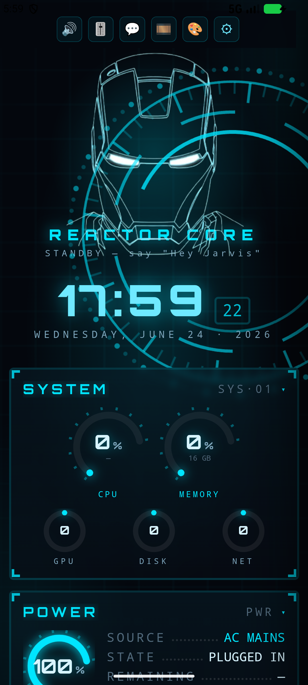
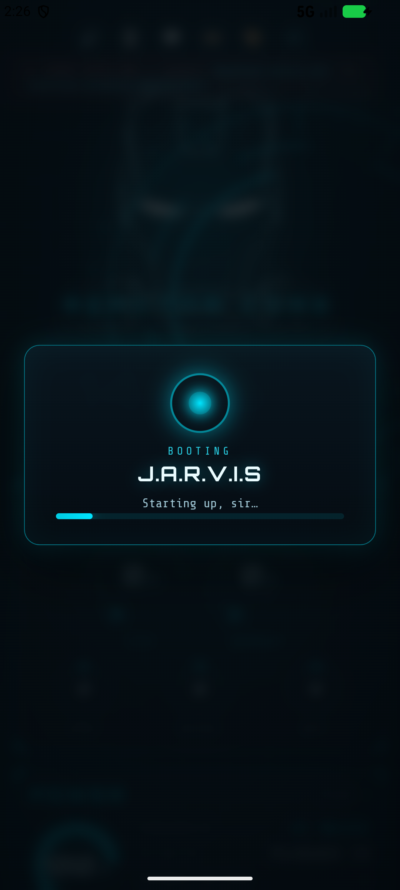
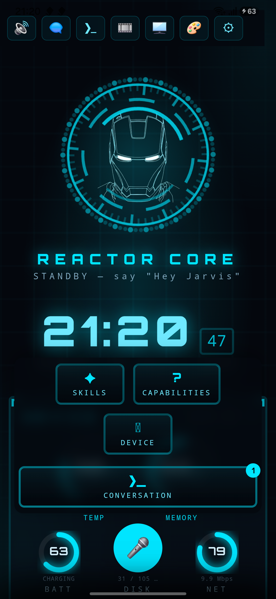
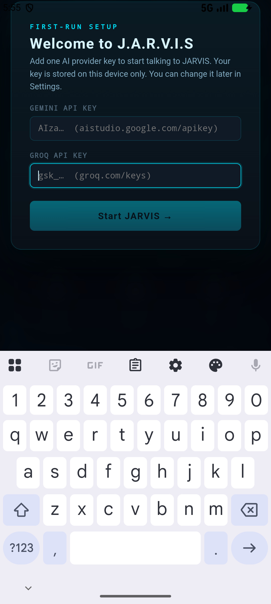

# JARVIS for Android

A voice assistant that runs on your phone. It chats, does real tasks over the internet
(weather, news, search, places, reminders), **drives other apps on the phone by itself**,
and can **remote-control your Windows PC**.

This folder (`aura-android`) is a separate fork of the Windows app in the sibling `aura`
folder. The two share no files — editing one never affects the other. The big difference:
on Windows the "brain" is a Python program the app talks to; here the brain is rewritten
in TypeScript and runs **inside the app**, so the phone needs no server and no Python.

| | |
|---|---|
| **What it is** | Tauri 2 (Rust shell) + React HUD + a TypeScript brain + a Kotlin Android plugin |
| **App id / version** | `com.jarvis.app` / 2.5.0 |
| **State** | Release APK v2.5.0 — 522 TypeScript tests + 148 native tests green, live-verified on SM-E156B (Android 16). See [docs/STATUS.md](docs/STATUS.md) |
| **Docs** | [Architecture](docs/ARCHITECTURE.md) · [Status](docs/STATUS.md) · [Security](docs/SECURITY.md) |

---


## Screenshots

<p align="center">
  
  &nbsp;
  
  &nbsp;
  
</p>
<p align="center">
  <em>Left: Iron Man mode on a real Galaxy M15 · Centre: HUD on the emulator · Right: boot screen</em>
</p>

<p align="center">
  
</p>
<p align="center">
  <em>First-run setup — paste a free Gemini or Groq key and tap Start</em>
</p>

---

## What it can do today

- **Chat + tools** — LLM chat with weather, news, web search, places/directions,
  reminders, alarms/timers, calendar, QR codes, image generation, clipboard and file
  reading.
- **Providers** — Vertex AI (a Service Account JSON key, runs on GCP credits), Google
  Gemini, or Groq, plus optional free OpenRouter / NVIDIA / Mistral keys. Pick provider
  and model in Settings, or let Auto mode choose: **smart routing** ranks every model your
  keys reach by benchmark score and sends each request to the weakest one that can handle
  it. When a free tier runs out the app walks that **route ladder** to the next key/model
  instead of giving up — per-minute limits are waited out, not treated as a day's ban.
- **Memory** — facts about you, playbooks and saved chats in one view (dock ▸ MEMORY or
  "open memory"), with a timeline and exact forget.
- **Voice** — push-to-talk mic, spoken replies, and on-device **"Hey Jarvis"** wake word
  running as an Android foreground service (keeps listening with the app in the
  background).
- **One-step phone actions** — flashlight, Do Not Disturb, ringer, play/pause/skip,
  volume, brightness, auto-rotate, lock screen; "message Mom on WhatsApp", "call Dad on
  WhatsApp", texts and phone calls by contact name (you confirm each one on screen first); "navigate to …" in Google
  Maps; "play … on Spotify"; reading your notifications and replying through them. Each
  asks for its permission the first time. Notification access is a restricted setting on
  sideloaded installs: App info ▸ ⋮ ▸ Allow restricted settings, then turn it on.
  Wi-Fi, Bluetooth, mobile data and airplane mode can't be switched by any app on
  Android 13+, so those still go through the operator below.
- **Phone control** — an AccessibilityService operator drives other apps step by step
  (read the screen → decide one action → do it → repeat), with a planner and a verifier.
  The loop runs natively in Kotlin, so a task keeps going after JARVIS leaves the screen.
  A floating **STOP** button works from any app.
- **Remote PC** — pair to the Windows JARVIS by scanning a QR code, then forward whole
  tasks to it, watch its screen live over WebRTC, and drive it by touch. Works on the
  same Wi-Fi or across networks via Tailscale.
- **TV** — control an Android TV on the same Wi-Fi by voice: open apps, play a show on
  Netflix or a YouTube search, pause, volume, power, remote buttons. It uses the TV's own
  USB debugging over the network, so nothing is installed on the TV (setup: Remote PC & TV
  screen). Two routers at home (a second one in router mode makes its Wi-Fi a separate
  network)? Switch the second one to Access Point mode, or install Tailscale on the TV and
  add its address after a comma.
- **When I get home** — a routine can run when you get home ("when I get home, turn on
  the TV and play lofi"). The phone recognises your home Wi-Fi by itself (the network
  where your TV or PC answers; no location permission) and shows a notification as you
  arrive: tap it and the routine runs.
- **Nightly memory digest** — once a night JARVIS reads what you said to it (your own
  words only) and keeps up to five new things worth remembering. They're ordinary
  facts: see or forget them in Memory, or switch the digest off there.
- **One memory** — what you tell JARVIS to remember, and your routines, are shared with
  the paired PC: tell either one, both know. Forgetting works the same way. A timed
  routine still goes off on the device you made it on.
- **TV by sight** — "what's on my TV?" looks at the TV's screen, and "on YouTube, play the
  second result for lofi" is done step by step, looking after each button press (nothing
  inside Netflix can be seen: it blocks screenshots).
- **Send this to the TV** — "send this to the TV" moves the YouTube video or Netflix show
  playing on the phone to the TV at the same point and pauses the phone (needs
  notification access). Or share a YouTube/Netflix link to JARVIS from any app's Share
  button and it plays on the TV.
- **Requests from your PC** — "set an alarm on my phone" said at the PC, or sent to the
  PC on WhatsApp (also from another number you allowed there), reaches the paired phone,
  which sets it and reports back. Only alarms, timers, reminders, the phone's switches,
  volume and music; JARVIS has to be open or recently used on the phone. Off in
  Settings ▸ PC & WhatsApp.
- **WhatsApp on the phone** — with the PC off, JARVIS can answer "Jarvis, …" messages
  from contacts you list (Settings ▸ PC & WhatsApp, needs notification access) through
  WhatsApp's own reply button. WhatsApp doesn't notify you about your own messages, so
  your "Message yourself" chat can't reach it here; give JARVIS its own number (WhatsApp
  Business on the phone works) to chat with it from yours. Built, not yet tested on a
  device.
- **Switching on from off** — "turn on the TV" also works when the TV is fully off
  (turn on Remote start in its network settings), and "turn on my PC" wakes the paired PC
  (Wake on LAN on in its BIOS and network adapter). Both use Wake-on-LAN, so the phone
  has to be on the same home network.

Known gaps and the things that still need a live on-device test are tracked in
[docs/STATUS.md](docs/STATUS.md).

---

## Build and run

All commands run from `jarvis-studio-gui/`.

Day-to-day checks (no Android toolchain needed):

```bash
npm run typecheck && npm run lint && npm test
```

Browser preview of the HUD (native plugins are absent, so phone control, wake word and
TTS won't work — layout and chat only):

```bash
npm run dev
```

Build and install a real debug APK (`ANDROID_HOME` and `NDK_HOME` must already be set):

```bash
npx tauri android build --debug --apk --target aarch64
```

```bash
adb install -r src-tauri/gen/android/app/build/outputs/apk/universal/debug/app-universal-debug.apk
```

```bash
adb shell am start -n com.jarvis.app/.MainActivity
```

No phone? From the repo root, this creates a `jarvis_test` emulator on first run, boots it,
installs the debug APK and opens JARVIS. `-Build` rebuilds the APK for arm64 + x86_64 first,
so the same file installs on the phone and the emulator:

```bash
powershell -ExecutionPolicy Bypass -File scripts/emulator.ps1 -Build
```

Things to know before you build:

- **`tauri android dev` hangs after building — don't use it.** Use `tauri android build`
  (it exits cleanly), then `adb install` + `adb shell am start`.
- **The emulator is for UI, onboarding and chat.** Audio, wake word, app control and PC
  pairing have only been verified on a real phone. `-Mic` routes the laptop microphone in,
  but nobody has tested voice through it yet.
- **Don't `adb shell am force-stop com.jarvis.app`.** Android then turns JARVIS's
  accessibility service off and every phone task fails until you re-enable it in
  Settings ▸ Accessibility. Restart with `adb install -r` or `am start` instead.

A signed release build reads `src-tauri/gen/android/keystore.properties` (copy
`keystore.properties.example`); without it the release APK falls back to the debug key
so it can still be sideloaded. `src-tauri/gen/android` is committed on purpose — it
carries hand-made settings (`allowBackup="false"`, the release cleartext rule, signing) that a fresh
`tauri android init` would drop.

## Releasing

Bump `version` in `jarvis-studio-gui/package.json` and `src-tauri/tauri.conf.json`,
commit, then tag and push: `git tag v2.5.0 && git push origin v2.5.0`. The Release
workflow (`.github/workflows/release.yml`) checks the app (typecheck, lint, tests),
builds a signed arm64 APK and publishes it as a GitHub release, which the app's update
notice then offers. It refuses a tag that doesn't match the version.

It needs the key the installed app is signed with, as repository secrets:
`ANDROID_KEYSTORE_BASE64` (the keystore, base64), `ANDROID_KEY_ALIAS` and
`ANDROID_KEYSTORE_PASSWORD`. Without them nothing is published — an APK signed with
another key can't update the app. (Built locally with the debug keystore so far? That's
`~/.android/debug.keystore`, alias `androiddebugkey`, password `android`.) "Run workflow"
on the Actions tab does a dry run with no release.

## Keys and security

JARVIS needs at least one free key — [Google AI Studio](https://aistudio.google.com/)
(Gemini) or [Groq](https://console.groq.com/) — entered in the app's Settings. OpenRouter,
NVIDIA and Mistral keys are optional extra fallbacks; a Vertex AI service-account JSON
works too. An optional [Tavily](https://tavily.com/) key backs up web search when Gemini
can't answer. Keys are stored on the phone encrypted with an Android Keystore key, are only
sent to the provider they belong to, and there are none in this repository.

Giving an assistant control of your phone is a real trust decision. What the app does to
limit that, and what is still open, is in [docs/SECURITY.md](docs/SECURITY.md). If you
find a vulnerability, please report it privately through GitHub's *Report a
vulnerability* (Security tab) rather than in a public issue.

---

## Layout

```
aura-android/
├── README.md                    ← you are here
├── CLAUDE.md                    ← instructions for AI coding assistants
├── docs/
│   ├── ARCHITECTURE.md          ← how the app is put together
│   ├── STATUS.md                ← what works, what's open, how it was verified
│   ├── SECURITY.md              ← the white-hat audit and its fix status
│   └── archive/                 ← the original 2026-06 plan + build log (history)
├── jarvis-studio-gui/           ← the app
│   ├── src/                     ← React HUD
│   │   ├── brain/               ← the TypeScript brain (see src/brain/README.md)
│   │   ├── components/, hud/, hooks/
│   └── src-tauri/               ← Rust shell
│       └── tauri-plugin-phone/  ← the Kotlin↔Rust↔JS Android plugin
```

The TypeScript brain was ported from the Windows app's Python backend. That original
lives in the desktop repo, not here.
