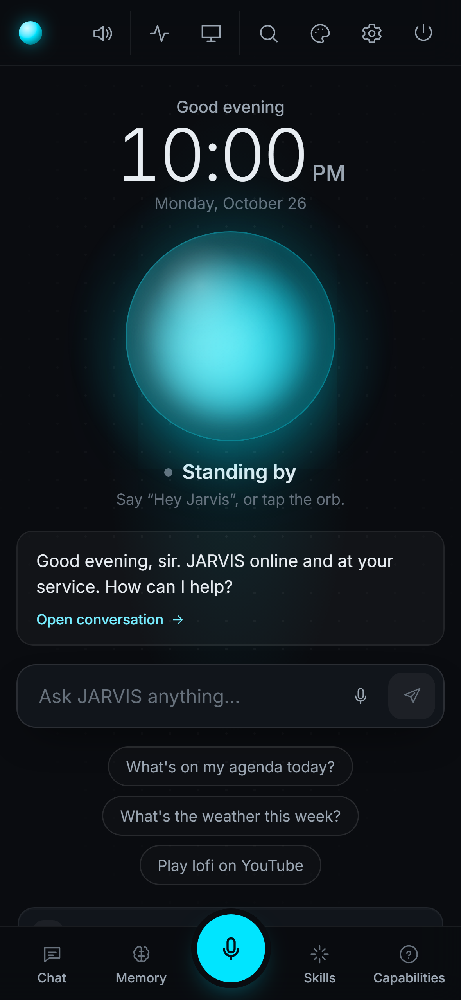
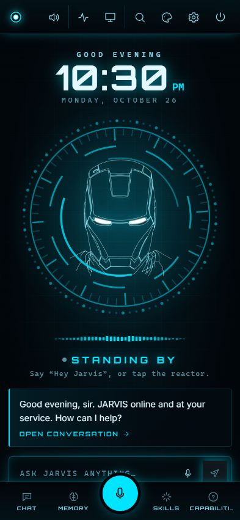

# JARVIS for Android

**Control your phone. Work on your PC. Boss your TV around.**

JARVIS is a voice assistant for Android that can open your apps, handle stuff on your paired Windows PC, dig up answers with sources, and actually remember things about you. Say **"Hey Jarvis"**, type something, or pick a specialist agent. Your call.

There's a new [ecosystem foundation preview](docs/ECOSYSTEM-IMPLEMENTATION.md) that adds Health and private diagnostics. It's off until you flip it on in Settings → Ecosystem Health → Foundation preview. Nothing about your current release changes, and the later ecosystem milestones are still waiting on the recorded live acceptance gate.

**[Download for Android](https://github.com/AnaaySampat/jarvis/releases/latest)**
· [Get started](#get-started)
· [What's new in v2.5.0](https://github.com/AnaaySampat/jarvis/releases/tag/v2.5.0)
· [Windows companion](https://github.com/AnaaySampat/jarvis-windows)

<table align="center">
  <tr>
    <th align="center">Modern</th>
    <th align="center">Iron Man</th>
  </tr>
  <tr>
    <td align="center"></td>
    <td align="center"></td>
  </tr>
</table>

## The good stuff

### Talk to your phone, and it just does things

Tell JARVIS to open an app, play a song, snap a photo or change a setting. It looks at your screen, works through the task one step at a time, and double-checks that it actually worked. It runs natively on Android, so it keeps going even when another app is in front. And if it starts doing something weird, there's a floating **STOP** button you can smash from anywhere.

The everyday stuff (flashlight, volume, brightness, music) skips all that and goes straight to your phone. Messages and calls work with contact names, and you get a confirmation on screen before anything goes out, so no accidental "I love you" to your boss. **"Hey Jarvis"** listens on-device through a foreground service, even when the app's in the background. Push-to-talk, spoken replies and conversation mode are in there too.

### Watch it work in chat

The 2.5.6-rc.3 build shows tool calls live inside each reply. Tap a row to peek at its safe inputs, outcome and timing. Longer phone/PC tasks stack their progress underneath, with links to Tasks and STOP. Activity sticks around with your saved chats, and if something gets interrupted, it comes back marked as unconfirmed so you can check on it. All of this is in the local signed APK, and the [validation status](docs/STATUS.md) has the details.

### Specialist agents (research runs right on your phone)

Pick an agent from the row in chat, use a handle like `@research`, or just say **"Tell the research agent to…"**. If you don't care, **Auto** picks the tools for you.

| Agent | What it's good at |
|---|---|
| **Research** | Searches the web, reads public sources, compares what it finds and answers with links. Runs on your phone, no PC needed. |
| **Phone** | Runs apps and handles device controls, messages and calls. |
| **Files** | Reads and summarises text files in a folder you give it access to. |
| **Scheduler** | Alarms, timers, reminders, your agenda and routines. |
| **Content** | Drafts posts, messages and docs, and makes images with a supported provider. |
| **Desktop & Browser** | Works in Windows apps or your PC's browser, signed-in sessions included. Needs the paired Windows app. |

Handoffs between agents and whatever they find show up right in the conversation. You can also attach a **photo or screenshot** and ask JARVIS about it.

### Hand gestures (preview)

On your phone, tap **Gestures** in the top action row to get set up and calibrated. **Guide** walks you through placement, practice and assigning actions. **Phone** gives you playback, volume, flashlight and brightness controls with no PC. Custom-pose capture now has you pick the action first, shows a countdown with progress, then lets you try a safe practice run.

Open **Hands-free** on Home to read, follow steps or control music. Reading and step buttons work even with the camera off. Hit **Learn** to practice without anything actually triggering, or **Tune** for presets and mappings, then fire up the camera when you're ready. Settings → Voice links to the same spot.

You can control music/TV, PC slides, push-to-talk, instructions and timers, reading/bookmarks, saved routines, mic mute, countdown photos, HUD pinch/drag and your own calibrated poses. Remap whatever you want and tweak the hold/release timing. Recognition stays on-device, there's always a visible Stop button, and sessions cap out at five minutes. Check [gesture controls](docs/GESTURE-CONTROLS.md) for setup, defaults and limitations.

### Your Windows PC, from your couch

Scan a QR code to pair, then **throw whole tasks at your PC**, watch its screen live and control it by touch. Works on the same Wi-Fi or from anywhere through Tailscale. Turn on Wake-on-LAN and you can wake the paired PC from your home network too.

It goes the other way as well. Say **"Set an alarm on my phone"** at your PC (or send it through the PC's WhatsApp integration) and it reaches your phone and reports back. Alarms, timers, reminders, device switches, volume and music all work. Switch it on under **Settings → PC & WhatsApp**.

### TV control, by voice and by sight

Tell JARVIS to play a Netflix episode, search YouTube, pause, change the volume or open an app on your Android TV. Ask **"What's on my TV?"** and it'll look at the screen. For visual stuff, it can click through menus and check each step as it goes. Heads up: protected screens like Netflix block screenshots, so those are a no-go.

Share a **YouTube or Netflix link** to JARVIS from Android's Share menu and it plays on your TV. Supported TVs can wake up too if Remote Start is on. TV control uses the TV's network debugging connection, so there's nothing to install on the TV itself.

### Memory and routines that follow you around

**Tell one device and both know.** Saved facts and routines sync between your phone and paired PC when they're connected. Forget something on one and it's gone from the other. There's an optional daily memory digest that skims your own messages while JARVIS is open and keeps up to five new facts. Review or delete them in Memory, or turn the digest off.

Got stuff you ask for all the time? Make it a named routine like **"movie night"** or **"bedtime"**. Run it by voice or from the home-screen card, and edit the steps and schedules right in the app. Timed routines can ping you even when JARVIS is closed, and you just tap the notification to run them. A synced timed routine keeps running on the device where it started.

**"When I get home, turn on the TV and play lofi."** Arrival routines spot your home Wi-Fi and send you a tap-to-run notification. No location permission needed.

### Cyan Iron Man HUD, or a clean Modern look

Go full **Iron Man** with the animated reactor and helmet, HUD fonts and ring gauges. Or keep it chill with the **Modern orb** and clean cards you saw up top. Tweak colours, fonts, glow, backgrounds (your own pic works too), card order and spacing. Save your own themes or import someone else's.

The home screen pulls together voice and device status, routines, weather, agenda, battery and network cards. There's a command palette, plus searchable settings, memory and recent chats, so nothing's hard to find.

### Pick your AI (with backups if one flakes out)

Use **Gemini, Groq or Vertex AI**, and toss in optional OpenRouter, NVIDIA and Mistral keys if you want. Pick a provider and model yourself, or let **Auto** route requests across whatever models your keys can reach. Smart routing looks at how hard the task is and how the models rank, and if a key or model hits a limit, JARVIS just tries the next one.

The whole assistant lives inside the Android app and uses the cloud AI providers you choose. **No PC and no self-hosted server needed** for the phone assistant or research.

## Try saying

| Say or type | What happens |
|---|---|
| "Hey Jarvis, open Spotify and play lofi." | Opens the app and runs it on your phone. |
| "@research compare three note-taking apps and cite your sources." | Researches and compares options right on your phone. |
| "Message Mom on WhatsApp: on my way." | Writes the message and waits for your thumbs-up. |
| "Play Stranger Things season 1 episode 1 on the TV." | Finds the episode and plays it on your TV. |
| "Remember that I prefer short answers." | Saves it and shares it with your paired PC. |
| "When I get home, turn on the TV and play lofi." | Sets up an arrival routine you run from its notification. |
| "Switch to Iron Man mode." | Changes up the home-screen look. |

Also in the box: weather, news, web search, places and directions, reminders, alarms, timers, calendar, notification reading and replies, QR codes, image generation and clipboard tools. Plain weather and notification reads take a direct tool path, and verification codes get redacted from notification text.

## Get started

**Android 7.0+ · 64-bit ARM · Current release: v2.5.0**

1. **[Grab the latest APK](https://github.com/AnaaySampat/jarvis/releases/latest)** and install it on your phone.
2. **Poke around without an AI key**, or **hook up a provider** during setup. Get a key from [Google AI Studio](https://aistudio.google.com/) or [Groq](https://console.groq.com/), or use a Vertex AI service-account JSON file for Google Cloud.
3. **Turn on what you want.** App control needs Android Accessibility access. Contacts, notification access and other permissions get requested when they're needed.
4. **Start with the mic or chat.** If you feel like it, open **Remote PC & TV** to pair the [Windows app](https://github.com/AnaaySampat/jarvis-windows) or set up your TV.

First launch gives you a quick intro to the buttons and lets you pick your shortcut bar. Add whatever shortcuts you like, reorder them, and swipe the bar if they don't all fit. You can change them or replay the intro any time under **Settings → Interface → Edit top bar**. **Capabilities** has example requests if you're stuck on what to say.

Your keys are encrypted on the phone with Android Keystore and only go to their own provider. Check [security and permissions](docs/SECURITY.md) to see how phone and PC control are protected.

<details>
<summary><strong>Compatibility, experimental features and test coverage</strong></summary>

- **PC features** need the paired Windows app. Keep it updated so shared memory and requests between devices keep working. Incoming requests need JARVIS open or recently used on the phone. Wake-on-LAN needs to be enabled on the PC and both devices on the same home network.
- **TV setup** needs network/USB debugging turned on and an address JARVIS can reach. Remote Start is what lets supported TVs wake up. If you've got separate router networks, you might need Access Point mode or a Tailscale address.
- **"Send this to the TV"** hands off supported YouTube or Netflix playback from your phone, and it needs notification access. YouTube uses the detected playback position, and Netflix uses its saved resume point. The phone-to-TV handoff still needs an end-to-end device test.
- **Phone-side WhatsApp commands** are experimental and still need an end-to-end device test. Listed contacts can send "Jarvis, …" requests, answered through WhatsApp's notification reply action, even when the PC is offline. Set it up in **Settings → PC & WhatsApp**. "Message yourself" doesn't create the notifications this relies on, so if you want to use your own number, JARVIS needs a separate number. Android's background limits may mean you have to tap a notification to keep things going.
- **Android permissions** can limit direct controls. Wi-Fi, Bluetooth, mobile data and airplane mode fall back to the step-by-step operator when direct switching is blocked. On Android 15+, JARVIS can only directly end the Do Not Disturb rule it started itself. For sideloaded notification access, you may need to go to **App info → ⋮ → Allow restricted settings** first.
- **Research** reads public page text, so JavaScript-only, login-protected or challenged pages might need another source. Places lookup can fail when public map services time out.
- **Recorded v2.5.0 validation:** 522 TypeScript tests passed (9 skipped) and 148 native tests passed, plus typecheck, lint and web/native APK builds. Device checks ran on an SM-E156B on Android 16 and a Sony BRAVIA TV. Per-feature coverage is in the status and device-test reports below.

See [feature status and known gaps](docs/STATUS.md), [device fixes and checks](docs/FIXES-2026-10-24.md) and [TV and notification test results](docs/TV-TESTING-2026-10-24.md).

</details>

---

## Build and run

The Android app runs on a Tauri 2 / Rust shell, a React interface, a TypeScript brain and a Kotlin plugin. Architecture and contributor notes live in [docs/ARCHITECTURE.md](docs/ARCHITECTURE.md) and [CLAUDE.md](CLAUDE.md).

Run everything from `jarvis-studio-gui/`.

Quick checks (no Android toolchain needed):

```bash
npm run typecheck && npm run lint && npm test
```

Want to see the HUD in a browser? Native plugins don't exist there, so phone control, wake word and TTS won't work. You just get layout and chat:

```bash
npm run dev
```

To build and install a real debug APK, make sure `ANDROID_HOME` and `NDK_HOME` are already set:

```bash
npx tauri android build --debug --apk --target aarch64
```

```bash
adb install -r src-tauri/gen/android/app/build/outputs/apk/universal/debug/app-universal-debug.apk
```

```bash
adb shell am start -n com.jarvis.app/.MainActivity
```

No phone? Run this from the repo root. It makes a `jarvis_test` emulator the first time, boots it, installs the debug APK and opens JARVIS. `-Build` rebuilds the APK for arm64 + x86_64 first, so the same file works on your phone and the emulator:

```bash
powershell -ExecutionPolicy Bypass -File scripts/emulator.ps1 -Build
```

Stuff to know before you build:

- **`tauri android dev` hangs after building, so don't use it.** Use `tauri android build` (it exits cleanly), then `adb install` + `adb shell am start`.
- **The emulator is for UI, onboarding and chat.** Audio, wake word, app control and PC pairing have only been checked on a real phone. `-Mic` pipes your laptop mic in, but nobody's tried voice through it yet.
- **Don't run `adb shell am force-stop com.jarvis.app`.** Android responds by switching off JARVIS's accessibility service, and every phone task breaks until you turn it back on in Settings ▸ Accessibility. To restart, use `adb install -r` or `am start` instead.

A signed release build reads `src-tauri/gen/android/keystore.properties` (copy `keystore.properties.example` to start). Without it, the release APK falls back to the debug key so you can still sideload it. `src-tauri/gen/android` is committed on purpose. It holds hand-made settings (`allowBackup="false"`, the release cleartext rule, signing) that a fresh `tauri android init` would wipe out.

## Releasing

The app checks for updates at launch and roughly every six hours in the background. When there's one, a popup shows the feature count, highlights and fixes. Users can download right in the app, snooze until tomorrow, skip a version, or check manually under **Settings → System → Updates**. Wi-Fi auto-download is optional. Before Android asks anyone to confirm the install, the APK gets checked against its release checksum and the installed app's package/signing identity.

For each release:

1. Bump the version in `jarvis-studio-gui/package.json`, its lockfile, `src-tauri/tauri.conf.json` and the app's Cargo package/lockfile. Set `bundle.android.versionCode` explicitly to something higher than every published build, RCs and betas included.
2. Add `docs/releases/v<version>.json` with `versionName`, `title`, `features` and `fixes`. Each highlight needs a stable `id`, a short `title` and an optional `description`. Add matching Markdown notes too.
3. Tag and push the matching version. `.github/workflows/release.yml` runs the checks, builds the signed arm64 APK, inspects its package/version/ABI, verifies the signature and generates `android-update.json` with the real APK size and SHA-256. Before publishing, it checks that the Android build code beats every published legacy and manifest-based release, uploads all assets to a draft, then publishes the whole release. The existing foundation-promotion gates still apply.

The release has to use the **same signing key as the installed app**, passed in through the repository secrets `ANDROID_KEYSTORE_BASE64`, `ANDROID_KEY_ALIAS` and `ANDROID_KEYSTORE_PASSWORD`. The updater rejects signing mismatches, and uninstalling is not an update strategy. "Run workflow" does a dry run and uploads artifacts without publishing anything.

The first updater-enabled release has to be installed through the existing release link. After that, people can update in the app. Background timing depends on Android's scheduling, and if notification permission is denied, the popup will be waiting next time JARVIS opens.

More in [the implementation plan and validation notes](docs/ANDROID-AUTO-UPDATE-PLAN.md).

## Keys and security

JARVIS needs at least one free key, either [Google AI Studio](https://aistudio.google.com/) (Gemini) or [Groq](https://console.groq.com/), entered in the app's Settings. OpenRouter, NVIDIA and Mistral keys are optional extra fallbacks, and a Vertex AI service-account JSON works too. You can also add a [Tavily](https://tavily.com/) key to back up web search when Gemini can't answer. Keys live on the phone, encrypted with an Android Keystore key, only go to the provider they belong to, and there are none in this repo.

Giving an assistant control of your phone is a real trust decision, and we don't take it lightly. [docs/SECURITY.md](docs/SECURITY.md) covers what the app does to limit the risk and what's still open. If you find a vulnerability, please report it privately through GitHub's *Report a vulnerability* (Security tab) instead of a public issue.

---

## Layout

```
aura-android/
├── README.md                    ← you are here
├── CLAUDE.md                    ← instructions for AI coding assistants
├── docs/
│   ├── ARCHITECTURE.md          ← how the app is put together
│   ├── STATUS.md                ← what works, what's open, how it was verified
│   ├── SECURITY.md              ← the white-hat audit and its fix status
│   └── archive/                 ← the original 2026-06 plan + build log (history)
├── jarvis-studio-gui/           ← the app
│   ├── src/                     ← React HUD
│   │   ├── brain/               ← the TypeScript brain (see src/brain/README.md)
│   │   ├── components/, hud/, hooks/
│   └── src-tauri/               ← Rust shell
│       └── tauri-plugin-phone/  ← the Kotlin↔Rust↔JS Android plugin
```

The TypeScript brain was ported over from the Windows app's Python backend. The original lives in the desktop repo, not this one.
