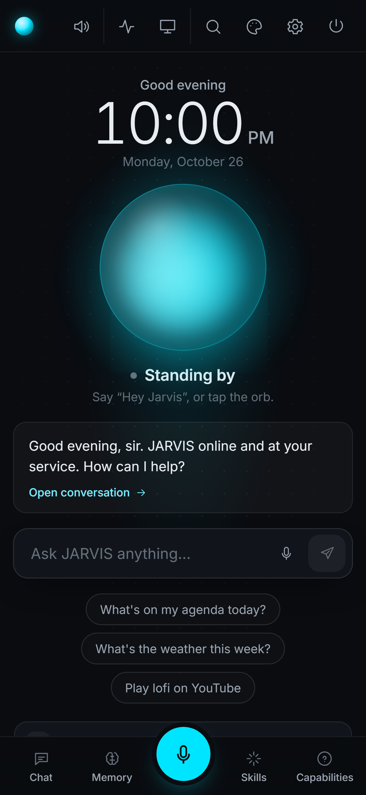
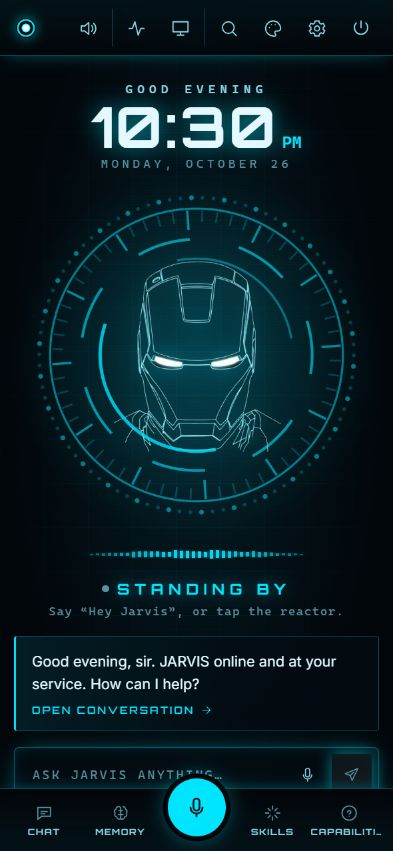

# JARVIS for Android

**Control your phone. Work on your PC. Command your TV.**

JARVIS is a voice assistant for Android that can use apps, carry out tasks on your
paired Windows PC, research with sources, and remember what matters to you.
Say **“Hey Jarvis”**, type a request, or choose a specialist agent.

**[Download for Android](https://github.com/AnaaySampat/jarvis/releases/latest)**
· [Get started](#get-started)
· [What's new in v2.5.0](https://github.com/AnaaySampat/jarvis/releases/tag/v2.5.0)
· [Windows companion](https://github.com/AnaaySampat/jarvis-windows)

<table align="center">
  <tr>
    <th align="center">Modern</th>
    <th align="center">Iron Man</th>
  </tr>
  <tr>
    <td align="center"></td>
    <td align="center"></td>
  </tr>
</table>

## The standout features

### Voice that can operate your phone

Ask JARVIS to open an app, play a song, take a photo or change a setting. Its phone
operator reads the screen, works through the task step by step and checks the result.
It runs natively on Android, so it can keep working while another app is on screen.
A floating **STOP** button lets you interrupt it from any app.

Everyday controls such as the flashlight, volume, brightness and music playback use
direct phone actions. Messages and calls can use contact names, with an on-screen
confirmation before they go out. **“Hey Jarvis”** listens on-device through a
foreground service, including while the app is in the background; push-to-talk,
spoken replies and conversation mode are available too.

### Specialist agents, including research directly on your phone

Pick an agent from the row in chat, use a handle such as `@research`, or say
**“Tell the research agent to…”**. **Auto** chooses tools for ordinary requests.

| Agent | What you can ask it to do |
|---|---|
| **Research** | Search the web, read public sources, compare findings and answer with links. Runs on the phone, with no PC required. |
| **Phone** | Operate apps and handle device controls, messages and calls. |
| **Files** | Read and summarise text files in a folder you grant access to. |
| **Scheduler** | Handle alarms, timers, reminders, your agenda and routines. |
| **Content** | Draft posts, messages and documents; generate images with a supported provider. |
| **Desktop & Browser** | Work in Windows apps or your PC's browser, including its signed-in sessions. Requires the paired Windows app. |

Agent handoffs and returned findings appear in the conversation. You can also attach
a **photo or screenshot** and ask JARVIS about it.

### Hand gestures (preview)

Open **Settings → Voice → Hand gestures**, choose a mode and start the camera.
Controls include music/TV, PC slides, push-to-talk, instructions and timers,
reading/bookmarks, saved routines, microphone mute, countdown photos, HUD pinch/drag
and calibrated personal poses. Remap gestures and adjust hold/release timing.
Recognition stays on-device with visible Stop controls and five-minute sessions.
See [gesture controls](docs/GESTURE-CONTROLS.md) for setup, defaults and limitations.

### Your Windows PC, from your phone

Pair by scanning a QR code, then **send whole tasks to your PC**, watch its screen
live and control it by touch. Use it on the same Wi-Fi or across networks through
Tailscale. With Wake-on-LAN enabled, you can also wake the paired PC from your home
network.

Requests work in the other direction too: **“Set an alarm on my phone”**, said at the
PC or sent through its WhatsApp integration, reaches the paired phone and reports
back. Supported requests include alarms, timers, reminders, device switches, volume
and music. Enable this under **Settings → PC & WhatsApp**.

### TV control by voice and sight

Tell JARVIS to play a Netflix episode, search YouTube, pause, change the volume or
open an app on your Android TV. **“What's on my TV?”** inspects the screen, and visual
tasks can work through menus while looking after each step. Protected screens such
as Netflix block screenshots.

Share a **YouTube or Netflix link** to JARVIS from Android's Share menu to play it on
the TV. Supported TVs can also wake with Remote Start enabled. TV control uses the
TV's network debugging connection, with no companion app installed on the TV.

### Memory and routines that connect your devices

**Tell either device once.** Saved facts and routines sync between your phone and
paired PC when connected. Forgetting a fact on one device removes it on the other.
An optional daily memory digest reviews your own messages while JARVIS is open and
keeps up to five new facts. Review or delete the facts in Memory, or turn off the digest.

Turn repeated requests into named routines such as **“movie night”** or **“bedtime”**.
Run them by voice or from the home-screen card, and add or edit their steps and
schedules in the app. Timed routines can notify you while JARVIS is closed: tap the
notification to run them. A synced timed routine keeps running on its original device.

**“When I get home, turn on the TV and play lofi.”** Arrival routines recognise your
home Wi-Fi and post a tap-to-run notification, without needing location permission.

### The cyan Iron Man HUD—or a clean Modern interface

Choose the animated **Iron Man reactor and helmet**, HUD typography and ring gauges,
or the **Modern orb** and clean cards shown above. Customise colours, fonts, glow,
backgrounds—including your own picture—card order and spacing. Save your own themes
or import them.

The home screen brings together voice and device status, routines, weather, agenda,
battery and network cards. A command palette and searchable settings, memory and
recent chats keep the controls easy to find.

### Choose your AI, with automatic fallbacks

Use **Gemini, Groq or Vertex AI**, with optional OpenRouter, NVIDIA and Mistral keys.
Choose a provider and model yourself, or use **Auto** to route requests across the
models your keys can access. Smart routing uses task difficulty and model rankings;
when a key or model hits a limit, JARVIS can try the next available route.

The assistant runs inside the Android app, using your chosen cloud AI providers.
**You can use the phone assistant and research without a PC or a self-hosted server.**

## Try saying

| Say or type | Put it to work |
|---|---|
| “Hey Jarvis, open Spotify and play lofi.” | Use an app on your phone. |
| “@research compare three note-taking apps and cite your sources.” | Research and compare options directly on the phone. |
| “Message Mom on WhatsApp: on my way.” | Prepare a message for your confirmation. |
| “Play Stranger Things season 1 episode 1 on the TV.” | Find and play an episode on your configured TV. |
| “Remember that I prefer short answers.” | Save a preference and share it with your paired PC. |
| “When I get home, turn on the TV and play lofi.” | Create an arrival routine that you run from its notification. |
| “Switch to Iron Man mode.” | Change the home-screen look. |

Also included: weather, news, web search, places and directions, reminders, alarms,
timers, calendar, notification reading and replies, QR codes, image generation and
clipboard tools. Plain weather and notification reads take a direct tool path;
verification codes are redacted from notification text.

## Get started

**Android 7.0+ · 64-bit ARM · Current release: v2.5.0**

1. **[Download the latest APK](https://github.com/AnaaySampat/jarvis/releases/latest)**
   and install it on your phone.
2. **Connect an AI provider** during setup. Add a key from
   [Google AI Studio](https://aistudio.google.com/) or [Groq](https://console.groq.com/),
   or use a Vertex AI service-account JSON file for Google Cloud.
3. **Enable the features you want.** App control needs Android Accessibility access.
   Contacts, notification access and other permissions are requested as needed.
4. **Start with the mic or chat.** Optionally open **Remote PC & TV** to pair the
   [Windows app](https://github.com/AnaaySampat/jarvis-windows) or set up your TV.

Keys are encrypted on the phone with Android Keystore and are sent only to their
provider. See [security and permissions](docs/SECURITY.md) for how phone and PC control
are protected.

<details>
<summary><strong>Compatibility, experimental features and test coverage</strong></summary>

- **PC features** need the paired Windows app; use a matching update for shared
  memory and requests between devices. Incoming requests need JARVIS open or recently
  used on the phone. Wake-on-LAN needs support enabled on the PC and the same home network.
- **TV setup** needs network/USB debugging enabled on the TV and a reachable network
  address. Remote Start is needed for supported TVs to wake. Separate router networks
  may need Access Point mode or a Tailscale address.
- **“Send this to the TV”** adds handoff of supported YouTube or Netflix playback
  from the phone, with notification access. YouTube uses the detected playback
  position; Netflix uses its saved resume point. A positive phone-to-TV handoff still
  needs an end-to-end device test.
- **Phone-side WhatsApp commands** are experimental and still need an end-to-end
  device test. Listed contacts can send “Jarvis, …” requests, answered through
  WhatsApp's notification reply action, including when the PC is offline. Configure
  this in **Settings → PC & WhatsApp**. “Message yourself” does not generate the
  notifications this needs; using your own number requires a separate number for
  JARVIS. Android background limits may require tapping a notification to continue.
- **Android permissions** can limit direct controls. Wi-Fi, Bluetooth, mobile data
  and airplane mode use the step-by-step operator where direct switching is blocked.
  On Android 15+, JARVIS can directly end only the Do Not Disturb rule it started.
  For sideloaded notification access, you may first need **App info → ⋮ → Allow
  restricted settings**.
- **Research** reads public page text; JavaScript-only, login-protected or challenged
  pages may need another source. Places lookup can fail when public map services time out.
- **Recorded v2.5.0 validation:** 522 TypeScript tests passed, 9 skipped; 148 native
  tests passed, plus typecheck, lint and web/native APK builds. Device checks used
  SM-E156B on Android 16 and a Sony BRAVIA TV; coverage for individual features is
  recorded in the status and device-test reports below.

See [feature status and known gaps](docs/STATUS.md),
[device fixes and checks](docs/FIXES-2026-10-24.md) and
[TV and notification test results](docs/TV-TESTING-2026-10-24.md).

</details>

---

## Build and run

The Android app uses a Tauri 2 / Rust shell, React interface, TypeScript brain and
Kotlin plugin. Architecture and contributor guidance are in
[docs/ARCHITECTURE.md](docs/ARCHITECTURE.md) and [CLAUDE.md](CLAUDE.md).

All commands run from `jarvis-studio-gui/`.

Day-to-day checks (no Android toolchain needed):

```bash
npm run typecheck && npm run lint && npm test
```

Browser preview of the HUD (native plugins are absent, so phone control, wake word and
TTS won't work — layout and chat only):

```bash
npm run dev
```

Build and install a real debug APK (`ANDROID_HOME` and `NDK_HOME` must already be set):

```bash
npx tauri android build --debug --apk --target aarch64
```

```bash
adb install -r src-tauri/gen/android/app/build/outputs/apk/universal/debug/app-universal-debug.apk
```

```bash
adb shell am start -n com.jarvis.app/.MainActivity
```

No phone? From the repo root, this creates a `jarvis_test` emulator on first run, boots it,
installs the debug APK and opens JARVIS. `-Build` rebuilds the APK for arm64 + x86_64 first,
so the same file installs on the phone and the emulator:

```bash
powershell -ExecutionPolicy Bypass -File scripts/emulator.ps1 -Build
```

Things to know before you build:

- **`tauri android dev` hangs after building — don't use it.** Use `tauri android build`
  (it exits cleanly), then `adb install` + `adb shell am start`.
- **The emulator is for UI, onboarding and chat.** Audio, wake word, app control and PC
  pairing have only been verified on a real phone. `-Mic` routes the laptop microphone in,
  but nobody has tested voice through it yet.
- **Don't `adb shell am force-stop com.jarvis.app`.** Android then turns JARVIS's
  accessibility service off and every phone task fails until you re-enable it in
  Settings ▸ Accessibility. Restart with `adb install -r` or `am start` instead.

A signed release build reads `src-tauri/gen/android/keystore.properties` (copy
`keystore.properties.example`); without it the release APK falls back to the debug key
so it can still be sideloaded. `src-tauri/gen/android` is committed on purpose — it
carries hand-made settings (`allowBackup="false"`, the release cleartext rule, signing) that a fresh
`tauri android init` would drop.

## Releasing

Bump `version` in `jarvis-studio-gui/package.json` and `src-tauri/tauri.conf.json`,
commit, then tag and push: `git tag v2.5.0 && git push origin v2.5.0`. The Release
workflow (`.github/workflows/release.yml`) checks the app (typecheck, lint, tests),
builds a signed arm64 APK and publishes it as a GitHub release, which the app's update
notice then offers. It refuses a tag that doesn't match the version.

It needs the key the installed app is signed with, as repository secrets:
`ANDROID_KEYSTORE_BASE64` (the keystore, base64), `ANDROID_KEY_ALIAS` and
`ANDROID_KEYSTORE_PASSWORD`. Without them nothing is published — an APK signed with
another key can't update the app. (Built locally with the debug keystore so far? That's
`~/.android/debug.keystore`, alias `androiddebugkey`, password `android`.) "Run workflow"
on the Actions tab does a dry run with no release.

## Keys and security

JARVIS needs at least one free key — [Google AI Studio](https://aistudio.google.com/)
(Gemini) or [Groq](https://console.groq.com/) — entered in the app's Settings. OpenRouter,
NVIDIA and Mistral keys are optional extra fallbacks; a Vertex AI service-account JSON
works too. An optional [Tavily](https://tavily.com/) key backs up web search when Gemini
can't answer. Keys are stored on the phone encrypted with an Android Keystore key, are only
sent to the provider they belong to, and there are none in this repository.

Giving an assistant control of your phone is a real trust decision. What the app does to
limit that, and what is still open, is in [docs/SECURITY.md](docs/SECURITY.md). If you
find a vulnerability, please report it privately through GitHub's *Report a
vulnerability* (Security tab) rather than in a public issue.

---

## Layout

```
aura-android/
├── README.md                    ← you are here
├── CLAUDE.md                    ← instructions for AI coding assistants
├── docs/
│   ├── ARCHITECTURE.md          ← how the app is put together
│   ├── STATUS.md                ← what works, what's open, how it was verified
│   ├── SECURITY.md              ← the white-hat audit and its fix status
│   └── archive/                 ← the original 2026-06 plan + build log (history)
├── jarvis-studio-gui/           ← the app
│   ├── src/                     ← React HUD
│   │   ├── brain/               ← the TypeScript brain (see src/brain/README.md)
│   │   ├── components/, hud/, hooks/
│   └── src-tauri/               ← Rust shell
│       └── tauri-plugin-phone/  ← the Kotlin↔Rust↔JS Android plugin
```

The TypeScript brain was ported from the Windows app's Python backend. That original
lives in the desktop repo, not here.
